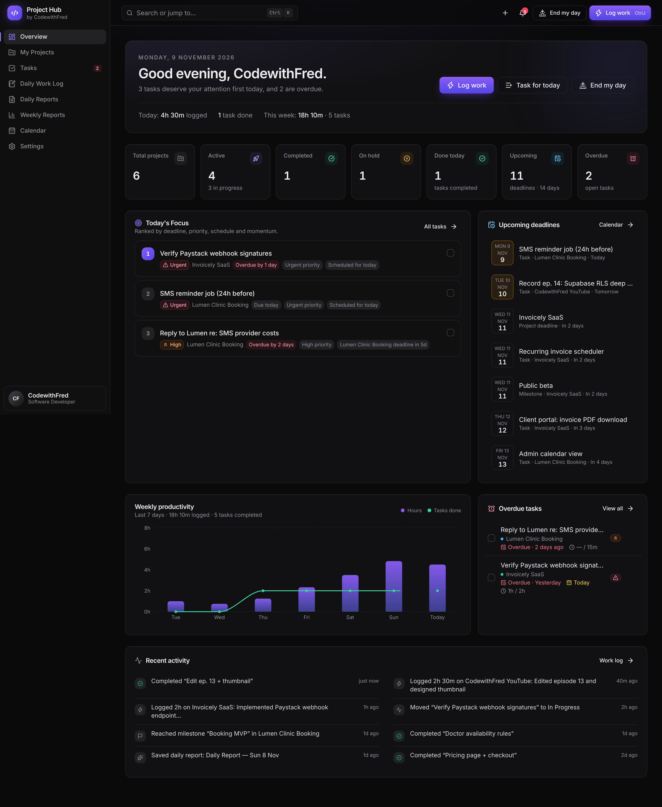
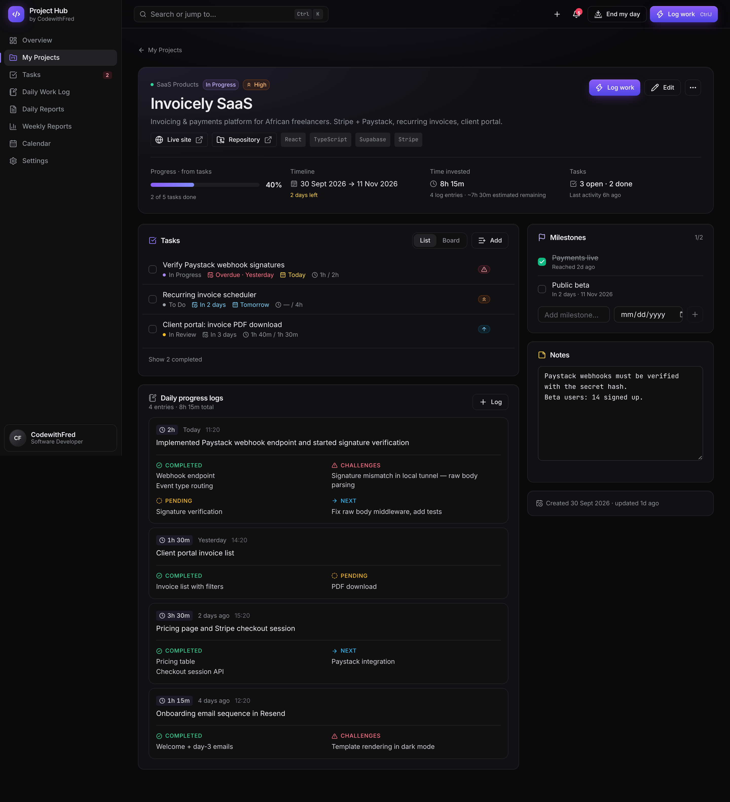
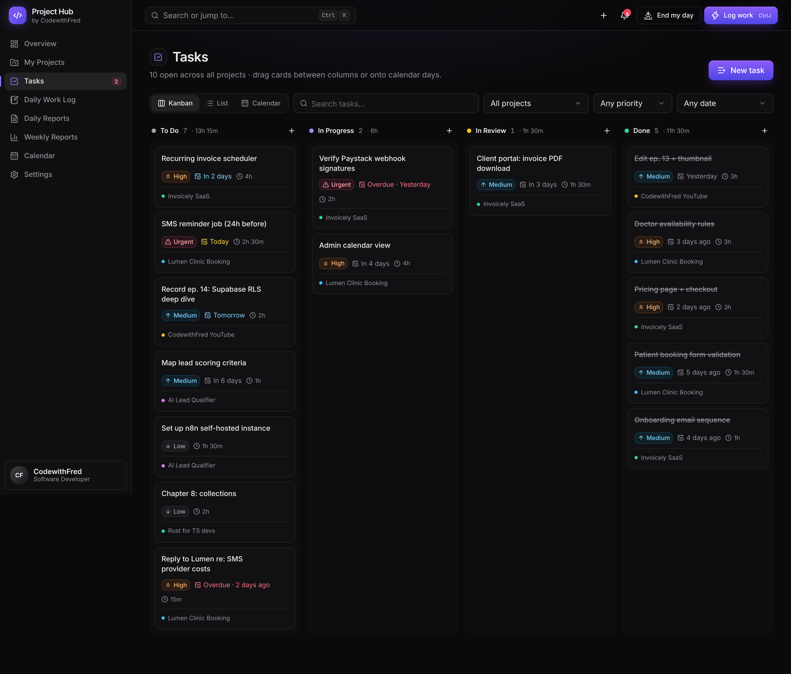
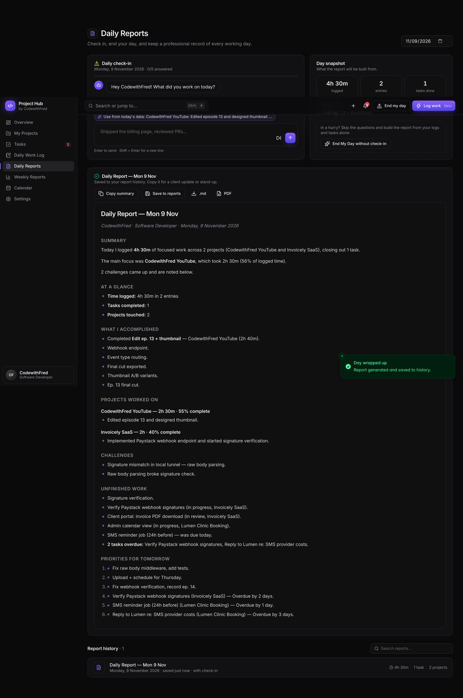
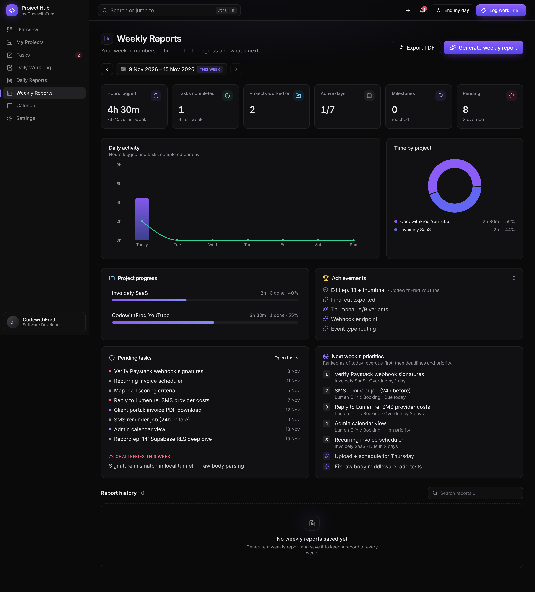
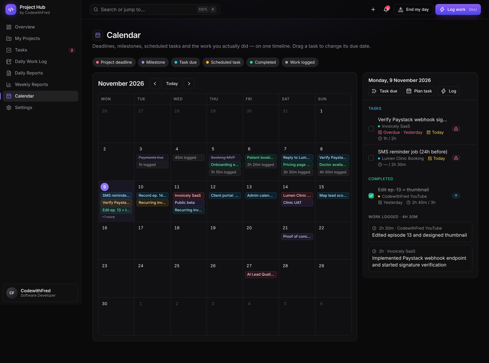
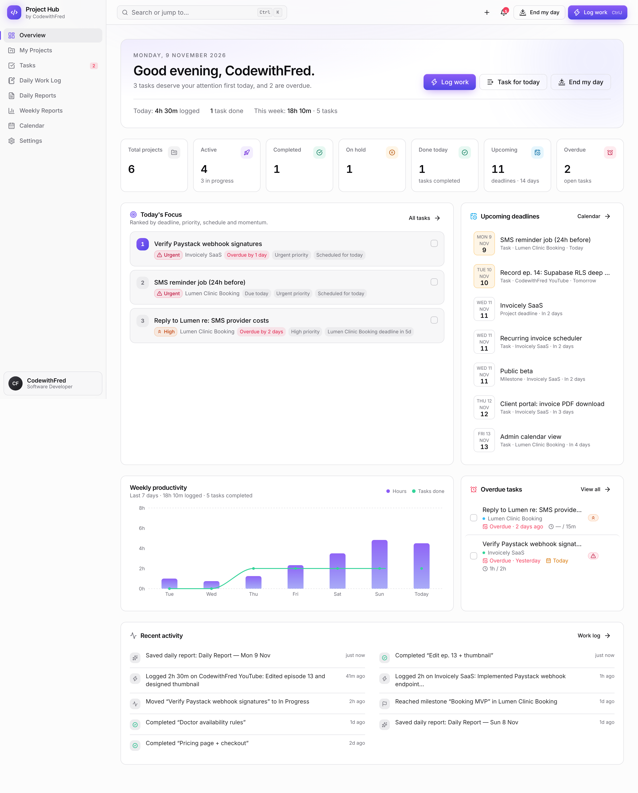
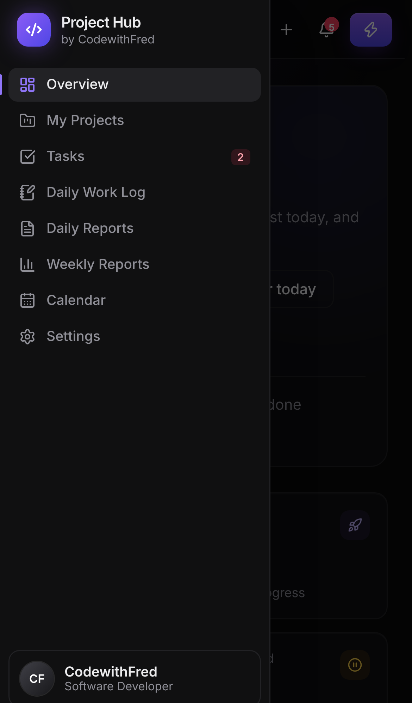

# CodewithFred Project Hub

> Every project. Every milestone. Every day. Under control.

This is a personal command center for one person, CodewithFred. It covers projects, tasks, daily work logs, check-ins, reports and reminders. There is no login: you open it and land on your dashboard.

## Screenshots

| Overview | Project detail |
| --- | --- |
|  |  |
| **Tasks: Kanban** | **End My Day report** |
|  |  |
| **Weekly report** | **Calendar** |
|  |  |
| **Light mode** | **Mobile** |
|  |  |

## Quick start

```bash
npm install
npm run dev        # http://localhost:5173
npm run build      # type-checks, then builds a static bundle into dist/
npm run preview    # serves the production build
npm test           # unit tests (auto-tracking logic)
```

You need Node 20 or newer. There are **no environment variables** and **no backend**.

## How data is stored

All data lives in the browser's **IndexedDB** (through Dexie). It persists across refreshes and restarts. The app also asks the browser for persistent storage so the data isn't evicted.

- **Back up regularly.** Go to Settings → Data → *Export backup (JSON)*. Use *Import backup* to restore, or to move to another browser or machine.
- If you clear site data, or open the app in a different browser or profile, you start empty.
- Nothing is sent over the network, so the app works offline once it has loaded.

## Deploying

The build output in `dist/` is a static SPA. You can host it anywhere: Vercel, Netlify, Cloudflare Pages or Nginx. Configure an SPA fallback so every route serves `index.html`:

- **Vercel:** already configured by the included `vercel.json` (SPA rewrites, asset caching, security headers).
- **Netlify:** add a `public/_redirects` file containing `/* /index.html 200`.

Each visitor's data stays in their own browser, so a public URL doesn't expose your data. If you want the URL itself to be private, use your host's access protection (for example, Vercel Deployment Protection).

## Features

| Area | What it does |
| --- | --- |
| **Overview** | Greeting and date in your timezone. Project counts (total, active, completed, on hold), tasks done today, upcoming deadlines, overdue tasks, a 7-day productivity chart, recent activity, and **Today's Focus**: the top 3 tasks, each with the reasons it was picked. |
| **My Projects** | Create, edit, delete, archive/restore, search, filter (status, category, priority), sort, and switch between grid and list views. A project has: category, status, priority, dates, progress, live URL, repository, technologies, notes, milestones, tasks and logs. |
| **Tasks** | Kanban board with drag-and-drop between columns, a grouped list (overdue / today / upcoming / no date / done), and a calendar view. You can drag tasks onto days to reschedule them. Filters: search, project, priority, due date, status. Each task has an estimated and an actual time. |
| **Daily Work Log** | Quick entry: pick a project (defaults to your last one), write one line, tap a time chip, save. That takes under 30 seconds. **Ctrl/⌘ + J** opens it from any page. History has search, project and date filters, edit, delete and "log again". |
| **Daily summary** | Generate Daily Summary, Generate Weekly Report, Copy summary, Save to reports, and download as `.md` or PDF. |
| **Daily Reports** | A conversational 5-question check-in that suggests answers from your data, then **End My Day**. That saves the report to history and can optionally save the check-in as a work log. |
| **Weekly Reports** | Week navigation, stats compared with last week, a daily-activity chart, time by project, project progress, achievements, pending tasks, challenges, next week's priorities, PDF export and report history. |
| **Calendar** | Project deadlines, milestones, task due and scheduled dates, completed tasks and logged time on one month view. Filter toggles, a panel for the selected day, and drag-to-reschedule. |
| **Reminders** | A notification center for upcoming deadlines (projects and milestones), overdue tasks, idle projects, today's tasks and a daily wrap-up reminder at a time you set. Browser notifications work after you grant permission. |
| **Settings** | Display name, role, timezone (default **Africa/Lagos**), week start, theme (dark/light/system), reminder time, per-type notification toggles and thresholds, report style, and backup/import/erase. |
| **Command palette** | **Ctrl/⌘ + K**: jump to any page, project or task, and run quick actions. Press **N** for a new task. |

### Automatic tracking (GitHub)

The hub can log your coding work for you. Connect GitHub in **Settings → Automatic tracking**: enter your username, and optionally a read-only token for private repos.

1. **Sync.** The hub reads your commits and pull requests, read-only, straight from the GitHub API. It syncs when you open the hub, every 30 minutes while it's open, and when you press *Sync now*. The first sync covers the last 14 days, so days you didn't open the hub are still picked up.
2. **Map to projects.** Each repo is matched to a project through that project's *GitHub repository* field. Repos you push to that aren't linked yet show up with a one-click *Link to project*.
3. **Suggest.** For each project and day, the **Detected work** panel (Work Log page and Daily Reports) builds a ready-made log entry:
   - what you worked on, taken from your cleaned-up commit messages
   - what was completed, including merged pull requests
   - what's pending, i.e. pull requests still open
   - an **estimated time**: commits less than 2h apart count as one session, and 30 minutes is credited per session before its first commit. Both values are configurable.
4. **You decide.** For each suggestion you can *Accept*, *Edit & save* or *Dismiss*, and every choice can be undone. When a commit looks like it finished an open task, the hub offers *Mark done*, but it never completes a task on its own.

Only commits authored by you count: matched by your GitHub login, or by extra commit emails you list. Merge commits are skipped. The token is stored only in this browser, is sent only to `api.github.com`, and is never written into backups.

### Rules the app follows

- **Tasks are only completed by you.** That means ticking a checkbox, dropping a card in Done, or choosing a status. The End My Day screen *offers* in-progress tasks for you to tick, but never completes them on its own.
- **Project progress** has two modes, and you pick one per project:
  - *Manual*: exactly the value you set.
  - *From tasks*: completed tasks ÷ total tasks, recalculated live.
- **Reminders fire once per condition.** Dismissed alerts don't come back. Rules are checked when the app loads, every minute while it's open, and shortly after your data changes. Browsers don't let a closed static site push notifications, so reminders only appear while the hub is open in a tab.

### Report generation

Reports come from a built-in, deterministic report writer (`src/lib/summary.ts`). It works from your logs, completed tasks, milestones, check-in answers and the Today's Focus ranking, and it never calls an external AI service.

## Tech stack

- React 19 and TypeScript, built with Vite
- Tailwind CSS with shadcn-style components on Radix primitives
- Lucide icons
- Dexie (IndexedDB) for live, reactive queries
- zod for validation
- Recharts for charts
- dnd-kit for drag-and-drop
- jsPDF for PDF export, loaded only when you export
- cmdk for the command palette
- sonner for toasts

## Project structure

```
src/
  lib/          types, db schema, repo (all writes + validation + activity log),
                insights (focus ranking, stats), summary (report writer),
                notifications (reminder rules), pdf, backup, dates (timezone-aware)
  hooks/        live data hooks (useSettings, useToday, useDataset, …)
  providers/    UI context: global project / task / quick-log dialogs
  components/   ui primitives, shell (sidebar, topbar, ⌘K, notifications),
                forms, tasks (row, kanban), calendar, charts, reports, worklog
  pages/        Overview, Projects, ProjectDetail, Tasks, WorkLog,
                DailyReports, WeeklyReports, Calendar, Settings
```

All writes go through `src/lib/repo.ts`. If you later move storage to a server database, that file and `hooks/data.ts` are the only parts that need replacing.
